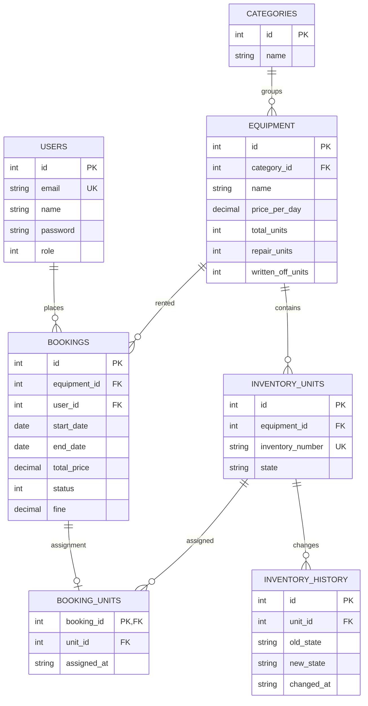

# ER-диаграмма базы данных

Выполнили: Фурсов Артем и Сподриков Матвей.

Связи и поля соответствуют основной схеме SQLite; полный набор полей и ограничений приведён в `database.sql`. Старый снимок `app_state` сохраняется при миграции.

